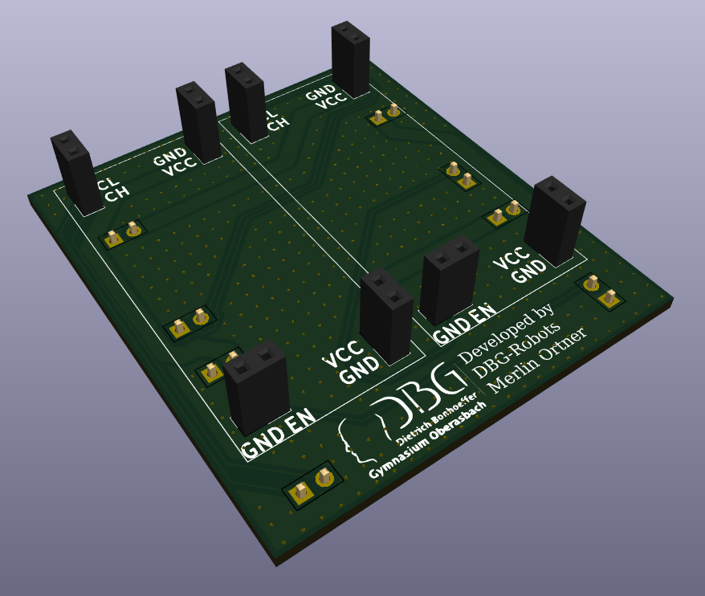

# PI5-HAT-relocator

 

Eine einfache, flache KiCad-Platine, mit der das Kinematics-Kit-HAT in einen schmalen Roboterrahmen passt: Buchsenleisten oben, Stiftleisten unten.

## Hintergrund

Unser Roboter nutzt das **[Kinematics Kit Kim](https://www.eduart-robotik.com/products/kinematicskit-kim)** von EduArt Robotik (Hersteller des Roboters Eduard) als Motor- und Antriebselektronik. Im Originallayout ragen die Motoranschlüsse **seitlich** aus dem HAT heraus. Für die meisten Aufbauten ist das unproblematisch, es kostet aber Breite, und genau die haben wir nicht.

## Das Problem

- **Breitenlimit von 30 cm.** Das ist die wichtigste Einschränkung, gegen die wir ankämpfen. Alles, auch die seitlich abstehenden Anschlüsse des Kits, muss in dieses Maß passen.
- **Sehr flacher Rahmen.** Unsere Doppelquerlenker-Federung (Double Wishbone, 3 Räder pro Seite) sitzt an den **Seiten** des Roboters. Die meisten anderen Roboter der Liga platzieren die Federung *unter* dem Elektronikgehäuse, was den Schwerpunkt nach oben verlagert. Wir haben uns für die seitliche Anordnung entschieden, um einen tieferen Schwerpunkt zu erreichen, dafür bleibt für die Elektronik aber deutlich weniger Platz in Breite und Höhe.

## Die Lösung

Diese Platine verlegt die Anschlüsse des HATs. Indem der obere Teil des Kinematics-Kit-HATs um **90°** gedreht wird, liegen die Motoranschlüsse nicht mehr seitlich abstehend, sodass das **komplette Kinematics Kit vollständig in unseren Rahmen passt**, und zwar innerhalb des 30-cm-Breitenlimits und mit dem flachen Profil, das wir brauchen.

Die Platine ist bewusst einfach gehalten:

- **Buchsenleisten oben** und **Stiftleisten unten**, sodass sie zwischen Pi/HAT und dem gedrehten oberen Teil sitzt.
- Kein Flachbandkabel, das hält den Aufbau niedrig und vermeidet zusätzlichen Platzbedarf und Verkabelung.
- Beschriftung im Bestückungsdruck (VCC, GND, EN und Signalpaare) an jedem Anschluss für einfachen Aufbau und einfache Fehlersuche.

## Pinbelegung

Die Platine führt 16 Pins durch (8 zweipolige Leisten oben, 8 unten). Pro Motorkanal (1 und 2) sind das `CH`, `CL`, `EN`, `VCC1`, `VCC2` und dazu `GND`.

Elektrisch gebraucht werden davon nur 6. Wir führen trotzdem alle 16 durch und bestücken alle Leisten:

- Die Stiftleisten halten den gedrehten oberen Teil mechanisch fest. Ohne sie säße er nicht stabil.
- Die Größe der Platine hängt an der Lage der Steckverbinder. Mit nur 6 Leitungen wäre sie weder kleiner noch billiger.
- So bleibt die Platine auch nutzbar, falls später mehr Pins gebraucht werden.

Leiterbahnen: Signale 0,2 mm, `VCC` 2,0 mm, `GND` als Fläche auf beiden Lagen.

## Prüfung

KiCad 10.0.3, Stand 11.11.2026:

- **DRC:** keine Fehler, keine offenen Verbindungen. Nur Warnungen: Bestückungsdruck überlappt, Footprints weichen von der Bibliothek ab, und bei x 117 / y 52 mm liegen zwei Durchkontaktierungen übereinander (eine davon kann weg).
- **ERC:** keine Meldungen.

## Dateien

| Datei | Beschreibung |
| --- | --- |
| `MotorControllerHeader.kicad_pro` / `.kicad_sch` / `.kicad_pcb` | KiCad-Projekt, Schaltplan und Platinenlayout |
| `PI5-HAT-relocator.step` | 3D-Modell der bestückten Platine |
| `production/` | Fertigungsdaten (Stückliste, Positionen, Netzliste, Zip) |
| `SketchPi2PHeaders.dxf` | Mechanische Skizze / Umrissreferenz |

## Credits

Entwickelt von DBG-Robots, Merlin Ortner (Dietrich-Bonhoeffer-Gymnasium Oberasbach).
[Kinematics Kit Kim](https://www.eduart-robotik.com/products/kinematicskit-kim) von EduArt Robotik.
