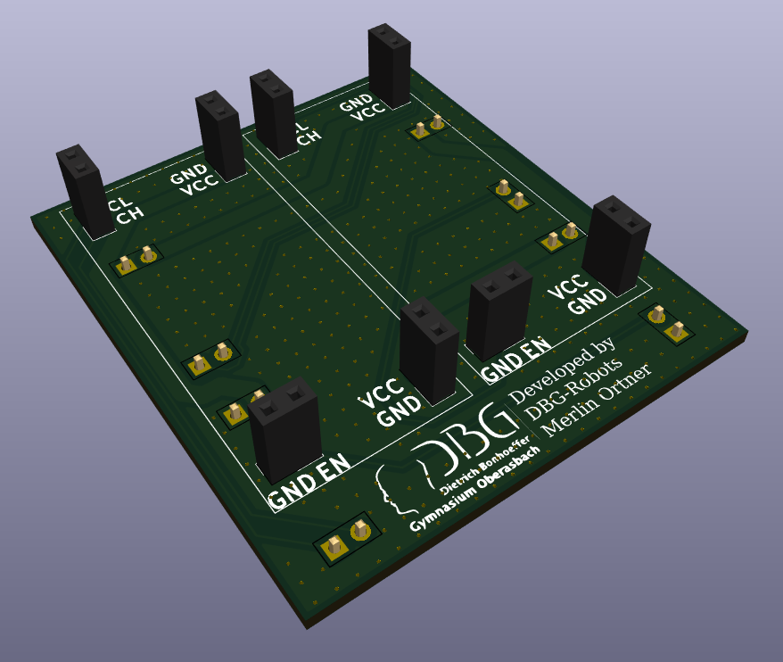

# PI5-HAT-relocator

A simple, shallow KiCad board that lets the Kinematics Kit HAT fit into a narrow robot frame: female connectors on top, male connectors on bottom.

## Background

Our robot uses the **Kinematics Kit** by Eduard as its motor and drive electronics. In its canonical layout, the motor connectors stick out on the **sides** of the HAT. That is fine for most builds, but it costs width, and width is exactly what we do not have.

## The problem

- **30 cm width limit.** This is the main constraint we are fighting. Everything, including the connectors that stick out of the kit, has to fit inside it.
- **Very shallow frame.** Our double wishbone suspension (3 wheels per side) is mounted on the **sides** of the robot. Most other robots in the league put the suspension *below* the electronics enclosure, which raises the center of mass. We chose the side-mounted layout for a lower center of mass, but it leaves a much narrower and shallower space for the electronics.

## The solution

This board relocates the connectors of the HAT. Rotating the top part of the Kinematics Kit HAT by **90°** brings the motor connectors out of the side-protruding position, so the **entire Kinematics Kit fits fully inside our frame** while staying within the 30 cm width limit and the low profile we need.

The board is intentionally simple:

- **Female connectors on top** and **male connectors on bottom**, so it sits between the Pi/HAT and the rotated top section.
- No ribbon cable, which keeps the stack low and avoids extra bulk and wiring.
- Silkscreen labels (VCC, GND, EN and signal pairs) on every connector to make assembly and debugging easy.

## Files

| File | Description |
| --- | --- |
| `MotorControllerHeader.kicad_pro` / `.kicad_sch` / `.kicad_pcb` | KiCad project, schematic and PCB layout |
| `PI5-HAT-relocator.step` | 3D model of the assembled board |
| `production/` | Fabrication outputs (BOM, positions, netlist, zip) |
| `SketchPi2PHeaders.dxf` | Mechanical sketch / outline reference |

## Credits

Developed by DBG-Robots, Merlin Ortner (Dietrich-Bonhoeffer-Gymnasium Oberasbach).
Kinematics Kit by Eduard.
